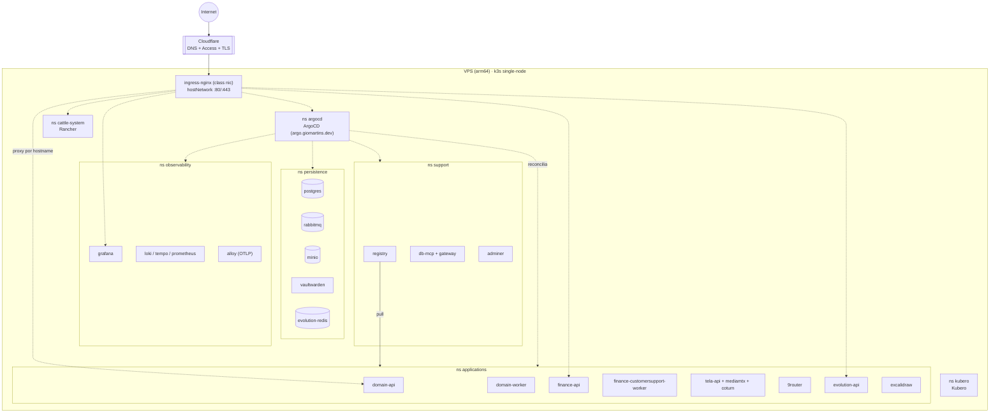
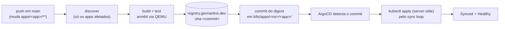
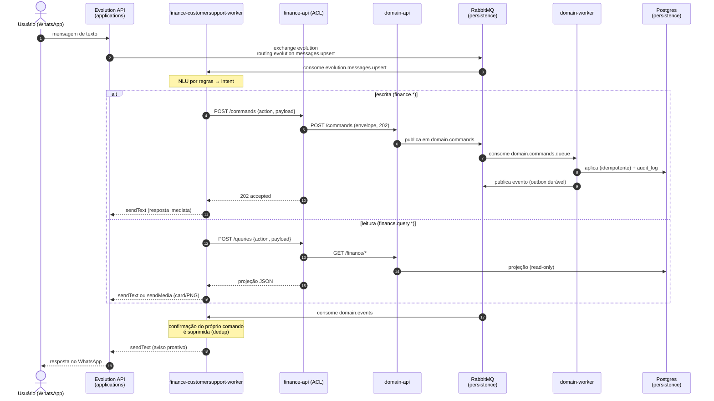
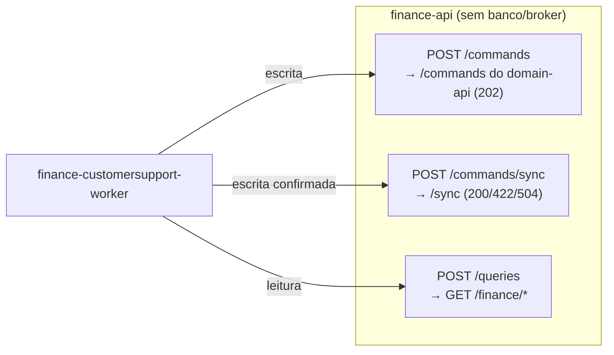
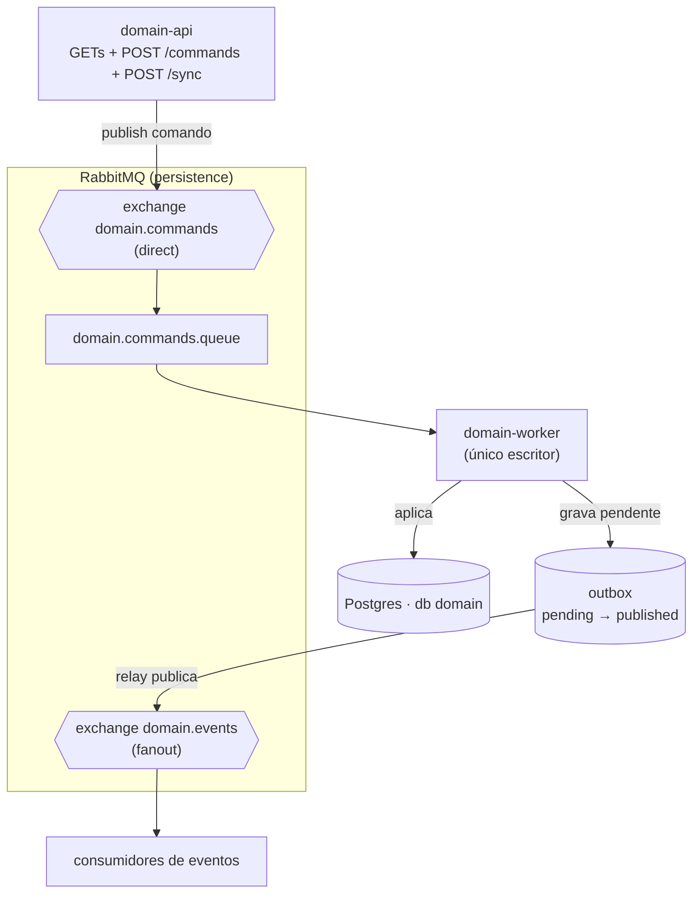

# Arquitetura

Visão **do que roda hoje**. Cada diagrama foi conferido contra o cluster vivo
(`kubectl get pods -A`) e contra `k8s/apps/`. Quando divergir, o código manda —
e se o código também divergir do cluster, o cluster é o bug.

- **Cluster**: k3s, um nó, arm64. Toda a carga em Kubernetes.
- **Apps** (o que é construído): `apps/*` → imagens no registry.
- **Manifests** (o que é reconciliado): `k8s/apps/<namespace>/<serviço>/`.
- **Infra de nuvem**: `infra/terraform` — Cloudflare (DNS, Access, mTLS) e
  baseline do host (firewall, pacotes).
- **Contrato compartilhado**: `packages/finance-contracts` (envelope + eventos,
  importado por `finance-api` e pelo worker, nunca copiado).

---

## 1. Visão geral

Um VPS (arm64) roda um cluster k3s de um nó. O **Cloudflare** fica na frente
de tudo (DNS + Access + TLS de borda). O tráfego entra pelo **ingress-nginx**
(`IngressClass nic`, `hostNetwork`, dono da :80/:443) e vai por hostname para
o Service certo. Um registro de container não existe mais: Docker zerado.

> **Frontends não são containers.** `tela-frontend`, `hub-frontend` e
> `finance-frontend` são builds estáticos espelhados em buckets do MinIO; o
> ingress serve o bucket direto.

> **`nic` é o único ingress.** Traefik e servicelb estão desabilitados no k3s
> (`--disable traefik --disable servicelb`) — dois controllers na :80 brigam.

---

## 2. Como o deploy chega ao cluster

Ninguém faz `kubectl apply` de workload. O caminho é git → imagem → digest →
ArgoCD.

O ApplicationSet (`k8s/bootstrap/appset.yaml`) varre `k8s/apps/<ns>/*` e cria
uma Application por diretório. **O basename do diretório é o nome da
Application** — renomear pasta apaga a Application e pruna os recursos,
inclusive PVC.

O manifesto fixa **digest**, não tag. Tag `latest` num manifesto GitOps
significa "o cluster deriva sozinho quando alguém publica".

---

## 3. O contexto financeiro — fluxo WhatsApp

O usuário fala por WhatsApp; o `finance-customersupport-worker` é o
**encarregado do atendimento**. A `finance-api` é a **ACL** (sem banco, sem
broker): valida e repassa. O `domain-api` é o front door do CQRS; o
`domain-worker` é o **único escritor** do banco.

**Regra de isolamento (§1.1):** nem a `finance-api` nem o worker têm
`DATABASE_URL`, driver de banco ou publicador de comando. Só o `domain` toca o
banco. O worker **consome** broker e **fala HTTP** com a ACL.

### Superfícies da ACL

---

## 4. CQRS — broker e persistência

O `domain-api` publica comando; o `domain-worker` é o único escritor e publica
eventos via **outbox durável** (o evento é gravado como pendente antes do
publish; um relay reenvia o que ficou, at-least-once).

---

## 5. Observabilidade

Todo app emite traces/métricas OTLP para o **alloy** (`:4318`, público em
`otel.giomartins.dev`); o stdout dos pods vai para o **loki**. Dashboards no
**grafana** (`grafana.giomartins.dev`, atrás de Access + login). `domain-api` e
o worker usam `OTEL_SERVICE_NAME` por serviço.

Estado (`loki-data`, `prometheus-data`, `grafana-data`, `tempo-data`,
`alloy-state`) mora em PVCs no namespace `observability`.

---

## 6. Ingress — o que decide o roteamento

Todo roteamento público é `Ingress` nativo (`networking.k8s.io/v1`) com
annotations `nginx.org/*`. O padrão e as armadilhas medidas estão em
[`../k8s/README.md`](../k8s/README.md) e nos comentários de
`k8s/apps/persistence/routes-persistence/ingress.yaml`.

Três regras que custam caro:

1. **`nginx.org/websocket-services` em request sem `Upgrade` manda
   `Connection: close`.** Já quebrou o 9router (abortava body de ~480 KB).
2. **O upstream gerado inclui o nome do Ingress.** Renomear o Ingress quebra
   snippets em silêncio — o reload falha e mantém a config anterior.
3. **O NIC não emite `proxy_http_version 1.1`** em Ingress nativo; vai por
   snippet em todos.

---

## Referências

- [`../k8s/README.md`](../k8s/README.md) — operação do cluster e armadilhas
- [`../apps/README.md`](../apps/README.md) — catálogo de apps
- [`finance-system-spec.md`](finance-system-spec.md) — spec do contexto financeiro
- [`novo-app-ci-cd.md`](novo-app-ci-cd.md) — criar app nova
- [`../apps/domain-api/README.md`](../apps/domain-api/README.md) — contrato de escrita/leitura
- [`../apps/finance-api/README.md`](../apps/finance-api/README.md) — a ACL
